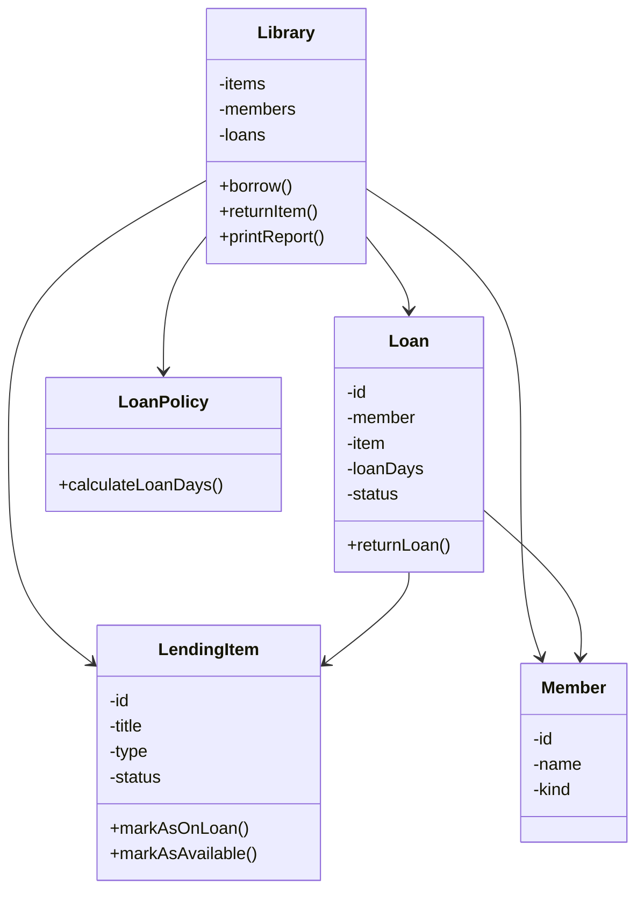

# The Reading Room – Code Diagnosis

## 1. Executive Summary

The Reading Room's lending tracker currently compiles and runs, but its internal design exposes it to data inconsistencies, incorrect lending records and difficulties maintaining existing functionality.

The most critical issue is that the system allows an item to be borrowed by multiple members simultaneously. This violates a fundamental business rule: an item must only have one active loan at any given time.

The application also suffers from poor encapsulation, tightly coupled responsibilities, weak identification mechanisms and loan rules that are difficult to extend.

The proposed rebuild will preserve the existing business behaviour while improving the internal architecture, enforcing lending constraints and making future extensions easier.

## 2. Identified Problems

### 2.1 No protection against duplicate active loans

**Root cause:** The `Library.borrow()` method does not check whether an item is already on loan before creating another loan record.

**Business risk:** The same physical item can be allocated to multiple members, resulting in conflicting records and uncertainty about who possesses the item.

**Priority:** Critical.

### 2.2 Poor encapsulation and uncontrolled state modification

**Root cause:** Important fields across `LendingItem`, `Member`, `Loan` and `Library` are publicly accessible. Additionally, `Library.getLoans()` exposes the internal mutable loan collection.

**Business risk:** External code can modify item availability, borrower information, loan status, member history and library collections without following the intended business operations. This can result in inconsistent or corrupted records.

**Priority:** High.

### 2.3 Loan identification relies on names and titles

**Root cause:** Loan records store the member's name and item title rather than references to uniquely identifiable member and item objects.

**Business risk:** Members with identical names and multiple copies of the same book become difficult to distinguish. The return operation can also incorrectly affect multiple loans sharing an item title.

**Priority:** High.

### 2.4 Loan policies are tightly coupled to the Library class

**Root cause:** The `Library.borrow()` method contains conditional logic for determining loan periods based on item and member types.

**Business risk:** Introducing new item categories requires modifying existing borrowing logic. Changes to one item type can unintentionally affect the rules governing another type.

**Priority:** High.

### 2.5 Business categories are represented by unrestricted strings

**Root cause:** Item types, member categories and loan statuses are represented using ordinary strings.

**Business risk:** Invalid values can enter the system without proper validation. Unknown item types can even result in loan records with zero loan days.

**Priority:** Medium.

### 2.6 The Library class has too many responsibilities

**Root cause:** The Library class manages item collections, members, loan transactions, loan-period calculations, returns and report generation.

**Business risk:** Responsibilities are tightly coupled, making the system difficult to understand, test and safely modify. Changes in one area can introduce unexpected problems in another.

**Priority:** High.

## 3. Most Dangerous Problem

The absence of protection against multiple active loans for the same item is the most dangerous problem for The Reading Room.

The library operates a physical lending service, meaning each physical item can only be in one person's possession at a time.

Allowing multiple active loans for one item compromises the reliability of the entire lending record system. Volunteers cannot confidently determine who is responsible for an item, creating accountability problems and increasing the risk of lost property.

This problem must be addressed as a core business invariant in the redesigned system.

## 4. Proposed Architecture

The redesigned application will separate responsibilities into focused classes.

Initial proposed components:

- `Library`: Coordinates library operations and manages members, items and loans.
- `LendingItem`: Represents an item and protects its availability state.
- `Member`: Represents a library member and maintains member-related information.
- `Loan`: Represents an individual borrowing transaction and its lifecycle.
- `LoanPolicy`: Responsible for determining loan periods based on item and member categories.
- `ItemType`, `MemberType` and `LoanStatus`: Enumerations representing controlled business categories and states.

### Initial architectural sketch

This is an initial conceptual design and may evolve during implementation.

The design aims to ensure that the Library coordinates borrowing operations, while individual objects protect their own state and responsibilities.

## 5. Design Rationale and Future Extensibility

The redesigned architecture will apply the following principles:

**Encapsulation:** Internal fields will be private, with controlled methods responsible for accessing and modifying object state.

**Separation of concerns:** Lending operations, loan-period calculations, item management and reporting will have clearly defined responsibilities.

**Unique identification:** Loans will reference identifiable members and items rather than relying exclusively on names and titles.

**Controlled business states:** Enumerations will replace unrestricted strings for item types, member categories and loan statuses.

**Extensible loan policies:** Loan-period rules will be separated from the Library class. An extensible policy design will allow new item categories, including e-loans, to introduce their own borrowing rules without continually modifying the central borrowing operation.

The final implementation will preserve the existing loan periods and normal lending behaviour while preventing multiple active loans for the same item.

