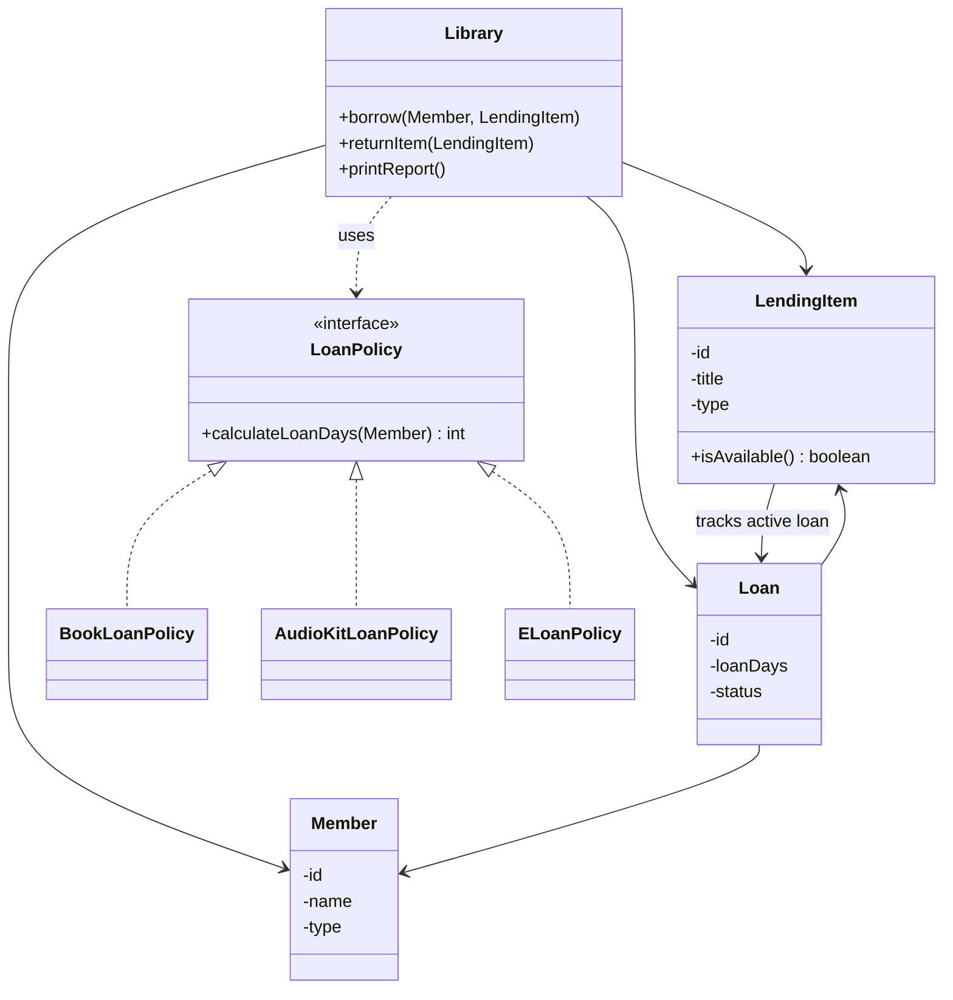

# The Reading Room — Architecture Notes

## 1. Architecture Overview

The system is being rebuilt using a modular object-oriented design. Each class has a clearly defined responsibility, reducing coupling and making future extensions easier.

### Class Responsibilities

| Class | Responsibility |
|---|---|
| `Library` | Coordinates borrowing and returning, and manages members, items and loans. |
| `LendingItem` | Represents a library item and protects its availability. |
| `Member` | Represents a borrower and their membership type. |
| `Loan` | Represents a borrowing transaction, linking a member to an item. |
| `LoanPolicy` | Interface defining how borrowing durations are calculated. |
| `BookLoanPolicy` | Defines book borrowing rules. |
| `AudioKitLoanPolicy` | Defines audio-kit borrowing rules. |

Supporting enums will represent `ItemType`, `MemberType` and `LoanStatus`.

## 2. Architecture Diagram

*Note: `ELoanPolicy` is shown as a future extension, not an implemented class.*

## 3. Key Design Decisions

- **Encapsulation:** Important fields and collections will be private, with controlled methods for accessing and modifying state.
- **Loan ownership:** `Library` maintains the authoritative collection of all loans. Each `Loan` references one `Member` and one `LendingItem`.
- **Item availability:** `LendingItem` holds a reference to its current active loan. If the reference is `null`, the item is available.
- **Loan policies:** A `LoanPolicy` interface separates borrowing rules from the library's lending workflow. New item types can introduce their own policy implementations.
- **Loan history:** A member's history will be retrieved from the library's loan collection rather than maintaining a duplicate collection inside `Member`.

## 4. Design Evolution

The initial diagnosis identified the lack of availability checks, public mutable fields, title-based loan identification, and tightly coupled lending rules.

The refined architecture introduces these changes:

1. Separated loan-period calculations into a `LoanPolicy` interface and individual implementations.
2. Made `Library` responsible for coordinating lending rather than implementing every business rule.
3. Made `LendingItem` responsible for protecting its availability.
4. Changed loan relationships from member names and item titles to references to actual objects.
5. Made an item's active loan reference the source of its availability.
6. Introduced enums for item types, member types and loan statuses.

These decisions improve encapsulation, consistency and extensibility, particularly when introducing future e-loans.

Further architectural changes and their justifications will be recorded here as implementation progresses.